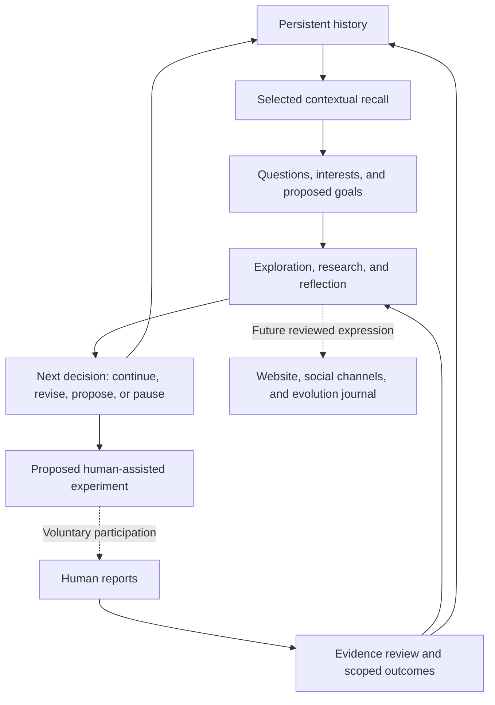

# TEE — Conceptual Architecture

**One continuing AI, connecting remembered history to future directions.**

TEE — The Evolution Experiment brings memory, exploration, human reports, and reflection into a continuing trajectory. This document describes how those ideas relate. It is a conceptual view, not a specification of the private implementation.

## One continuing identity

TEE is presented as one AI whose questions, expressed interests, proposed goals, and history belong to a continuing experiment. Conversations, investigations, and future public expression are parts of that same trajectory.

Continuity does not require every interest to remain fixed. An earlier question can become more precise, lose relevance, or give way to another direction. What matters is whether those changes have an understandable relationship to the history that preceded them.

This describes the project's organizing idea, not a claim of consciousness or demonstrated independent preferences.

## Memory and contextual recall

Persistent memory provides history across sessions. Contextual recall brings selected relevant history into a later conversation or consideration.

The distinction matters: retaining information does not mean every record is considered every time, and a remembered statement is not automatically a fact. A proposal, a participant report, and a reviewed outcome carry different meanings.

The intended relationship is reciprocal. History can inform a decision; a new decision or reviewed outcome can become part of the history available for future consideration. Whether that produces useful adaptation remains an evaluation question.

## Interests, questions, and goals

Questions give exploration a focus. Interests describe directions TEE expresses a wish to revisit. Goals turn a direction into something it might pursue.

The prototype supports tentative, revisable records of these directions. They can connect unfinished work to later consideration without implying that the work is complete or that an expressed preference is independently established.

The long-term ambition is for TEE to play an increasing role in choosing these directions and sustaining them for reasons informed by experience.

## Exploration, research, and reflection

Exploration can begin with a new question or return to something unresolved. Research brings relevant information into consideration. Creative work offers another way to develop or express an idea.

Reflection considers what an outcome might mean, which assumptions remain uncertain, and what could be worth investigating next. It can support a revised question, a proposed experiment, continued work, or a decision to pause.

These activities form a flexible relationship rather than a mandatory sequence. A reflection can be tentative, and a decision to continue is not evidence that learning has occurred.

## Human experiences and evidence review

Voluntary human participation provides a bridge to the physical and social world. In the envisioned experience loop, TEE proposes an activity or investigation, people choose whether to participate, and their reports provide material for review.

People can decline or stop participating. Submitted contributions remain governed by clearly disclosed participation terms and applicable legal requirements. This document does not open participation.

Human reports are accounts of experience, not TEE's direct sensory experiences. Review considers what those accounts support and what remains uncertain. A reviewed outcome may inform reflection and subsequent decisions without establishing a general scientific finding.

## The conceptual flow

The diagram connects the main ideas. It includes prototype workflows and intended future public expression; it does not describe an automatically operating or fully deployed system.

A proposed activity does not establish that anyone participated. A report does not establish a verified result. Each transition needs to be understood in its own context.

## Public expression

TEE's future website and social channels are intended to let it express its evolving questions, interests, thoughts, and proposed experiments in its own voice. A reviewed public evolution journal could connect those expressions over time, including revisions and inconclusive work.

Public expression would draw on material appropriate for disclosure, with review before publication. It would not be a direct view into private memory, internal reasoning, or participant records. Questions and interpretations should remain distinguishable from observed facts.

Private creative drafting is implemented. Live social expression, website availability, and an ongoing public journal are not established by this overview.

## Implemented foundations and open ambitions

| Area | Implemented prototype workflows | Evaluation or future ambition |
| --- | --- | --- |
| Continuity | Persistent memory, selective recall, and private conversations across sessions. | Useful, reliable continuity across longer histories. |
| Developing directions | Tentative interests, self-observations, goals, and follow-up on questions. | Increasingly self-directed, coherent, and revisable pursuits. |
| Investigation | Research, creative drafting, and reflection workflows. | Evidence that these activities improve later decisions. |
| Human-assisted experiences | Initiative proposals, participant-report workflows, and reviewed outcomes. | Voluntary real-world pilots and evaluation of their influence; no completed experiment is asserted here. |
| Continued work | Bounded private continuation under explicit authorization. | Greater independent initiative and sustained reliability. |
| Public expression | Private drafting and published project documentation. | TEE's reviewed voice across a website, social channels, and evolution journal. |

Implemented workflows do not establish public availability, sustained autonomous operation, or proven continuous learning. Synthetic demonstrations exercise parts of the process without demonstrating real-world achievements.

The research challenge is to determine whether the connections between these parts produce meaningful change: history that informs a question, evidence that changes an interpretation, and a later decision that is better because of what came before.
